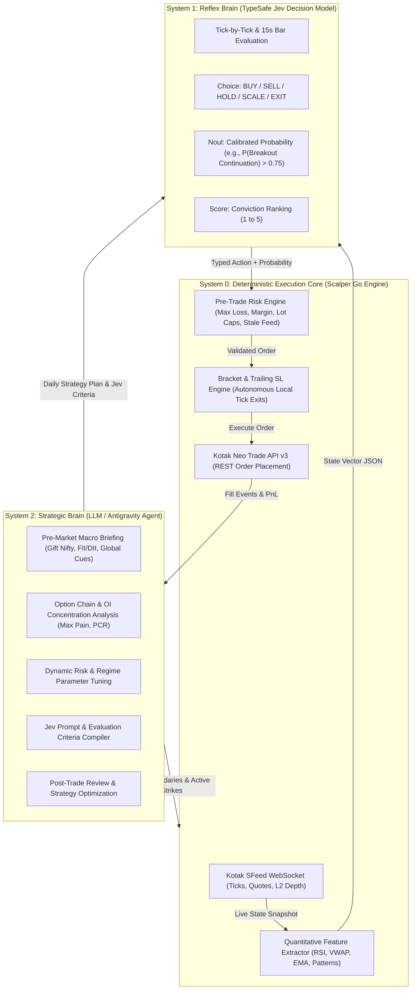

# Feasibility Study: Integrating Jev Decision Models & LLM Reasoning Agents for Intraday Trading in Scalper

**Document Version:** 1.0.0  
**Date:** November 2026  
**Status:** Feasibility & Architectural Blueprint  
**Target Repository:** `github.com/akshaykhairmode/scalper`

---

## Executive Summary

This study evaluates the feasibility of integrating **TypeSafe AI's Jev model** ("System 1" Fast Decision Model) alongside an **LLM Reasoning Agent** ("System 2" Strategic Agent) into the **Scalper** terminal to perform automated or semi-automated intraday options trading on Indian derivatives (NIFTY, BANKNIFTY, SENSEX) via Kotak Neo Trade API v3.

### Bottom-Line Verdict: **HIGHLY FEASIBLE (Short-to-Medium Horizon Intraday Scalping)**

| Trading Strategy Horizon | Latency Profile | Feasibility | Recommendation |
| :--- | :--- | :--- | :--- |
| **Micro-structure HFT / Sub-millisecond Arbitrage** | < 10 ms | ❌ **Not Feasible** | Kotak Neo cloud REST execution (150–350 ms) and SFeed latency make micro-tick arbitrage impossible regardless of model speed. |
| **Momentum Scalping (15s – 1m bars / Level-2 Depth bursts)** | 350 ms – 800 ms |  **Highly Feasible** | Fits comfortably within Jev's sub-second inference window (100–300 ms) and Kotak order placement latency. |
| **Breakout & Reversal Trading (1m – 5m bars)** | 1 s – 3 s |  **Optimal Fit** | Maximizes Jev's calibrated scoring and pattern alignment while allowing real-time risk validation. |
| **Intraday Trend Following & Option Selling (15m – 60m)** | > 5 s |  **Highly Feasible** | Leverages System 2 Agent for macro regime detection, Greeks management, and trailing adjustments. |

The integration is technically viable and economically compelling:
1. **Low-Latency Decision Loop:** Jev’s bounded, schema-constrained outputs eliminate LLM parsing overhead and token generation delays, achieving 70 ms – 350 ms inference.
2. **Robust Safety Harness:** Scalper already possesses a production-grade pre-trade risk engine (`internal/web/risk.go`) and an autonomous bracket/trailing stop-loss engine (`internal/bracket/engine.go`) running in native Go. This guarantees that **no hallucinated or runaway trade can bypass local safety limits**, even during network partitions.
3. **Negligible Operating Cost:** Jev token pricing ($0.042 / 1M input tokens, $0 output tokens) combined with periodic LLM calls brings total daily AI compute cost to **under $0.25 / trading day**.

---

## 1. The Tripartite Architecture: System 0, System 1, and System 2

Intraday trading fails when a single model attempts to handle everything from macroeconomic reasoning to sub-second order cancellation. We propose a **Tripartite Architecture**:



### Breakdown of Model Specializations

| Component | Technology | Primary Role | Latency | Execution Frequency |
| :--- | :--- | :--- | :--- | :--- |
| **System 2 (Reasoning Agent)** | Antigravity / Gemini 1.5 Pro / Claude 3.5 Sonnet | Macro context, regime detection, dynamic parameter generation, prompt synthesis, post-trade audit, natural language copilot | 2,000 – 8,000 ms | Periodic (Pre-market 09:00 AM, hourly, or on volatility spikes) |
| **System 1 (Decision Model)** | TypeSafe AI `jev-latest` | Bounded tactical decisions (`Choice`), directional probability estimation (`Noul`), setup grading (`Score`) | 80 – 350 ms | High-frequency (Every 15s/1m bar close, or on key level touch) |
| **System 0 (Execution Core)** | Scalper (Native Go Backend) | SFeed tick ingestion, feature calculation, strict pre-trade risk gating, bracket trailing SL, Kotak Neo order routing | 0.5 – 5 ms | Real-time (Every incoming WebSocket tick) |

---

## 2. Scalper Repository Readiness Assessment

Scalper’s current codebase provides an exceptionally mature foundation for algorithmic automation. The table below audits current components against autonomous trading requirements:

| Module in Scalper | Current Capability | Readiness for AI Trading | Gaps / Required Enhancements |
| :--- | :--- | :--- | :--- |
| **`internal/market/hsm.go`** & **`feed.go`** | Kotak Neo SFeed WebSocket streaming quotes, LTP, Open Interest, and L2 market depth (`Bids`, `Asks`). |  **Production Ready** | Needs a standardized in-memory ring-buffer to feed real-time feature calculators without allocations. |
| **`internal/bracket/engine.go`** | Complete bracket & OCO engine with trailing stop-loss, tick-by-tick evaluation (`OnTick`), and SQLite persistence. |  **Production Ready** | Add programmatic entry API hook so the strategy engine can dispatch bracket orders directly. |
| **`internal/web/risk.go`** | Hard pre-trade risk controls: `MaxLotsPerOrder`, `MaxOpenLotsPerIndex`, `MaxDailyLossINR`, `BlockOnDataStaleMS`, `CheckBeforeOrder`, rate limits. |  **Production Ready** | Add `MaxDailyTrades` and `ConsecutiveLossBreaker` to prevent over-trading in choppy markets. |
| **`internal/kotakapi/client.go`** | Kotak Neo v3 client supporting Market, Limit, IOC orders, order history audit trail, margin checks, and session management. |  **Production Ready** | None. Rate limiter already handles broker concurrency constraints. |
| **`web/src/chart/patterns.ts`** | Comprehensive 1,449-line pattern recognition engine (candlesticks, double tops/bottoms, Wyckoff sweeps, harmonics). | ⚠️ **Frontend Only** | Pattern detection currently runs in browser TypeScript. Needs porting or a lightweight Go feature extraction port for server-side evaluation. |
| **`internal/store/`** | SQLite storage for sessions, historical candles, bracket states, and scrip cache. |  **Production Ready** | Add an `ai_decisions` table to log Jev inputs, responses, and execution results for audit and backtesting. |

---

## 3. Detailed Feasibility Analysis Across 5 Dimensions

### Dimension 1: Technical & Latency Feasibility

#### The Latency Budget for Options Scalping

In Indian options trading, momentum breakouts and reversals typically develop over **3 to 45 seconds**. A successful automated execution must complete the entire cycle from tick arrival to broker acknowledgement in **under 1 second**.

```
[Kotak SFeed Tick]  ──(50–150ms)──> [Scalper Feature Vector] ──(2–5ms)──>
[TypeSafe Jev API]  ──(120–300ms)─> [Scalper Risk Check]    ──(0.5ms)──>
[Kotak Order REST]  ──(150–350ms)─> [Exchange Fill ACK]
─────────────────────────────────────────────────────────────────────────
Total Turnaround Time: 322 ms – 805 ms (Well within 1-second bar limits)
```

#### Why Jev is Feasible Where LLMs Fail
1. **Zero Text Generation Overhead:** Standard LLMs (GPT-4, Claude) stream tokens autoregressively. Generating even 50 tokens of JSON takes 1,200 ms – 3,000 ms, causing severe execution slippage on fast moves.
2. **Deterministic Schemas:** Jev evaluates natural language criteria directly against typed targets (`Noul`, `Choice`, `Score`). No JSON syntax parsing errors, markdown backticks, or prompt hallucinations occur.
3. **HTTP Keep-Alive Connection Pooling:** A dedicated Go HTTP client maintaining persistent TLS connections to `api.typesafe.ai` reduces network latency to pure round-trip transit.

---

### Dimension 2: Financial & Market Microstructure Feasibility

#### Dealing with Indian Derivatives Dynamics

1. **Option Premium Volatility & Decay:**
   - Out-of-the-money (OTM) options suffer rapid theta decay and wide bid-ask spreads.
   - **Requirement:** System 2 must restrict Jev's active trading universe strictly to **At-The-Money (ATM) or In-The-Money (ITM) strikes** (delta between 0.45 and 0.65) where liquidity is highest.
2. **Bid-Ask Spread Slippage:**
   - In fast markets, placing pure market orders (`MKT`) can result in slippage of 2 to 5 points.
   - Scalper already streams 5-level market depth (`Bids`, `Asks`).
   - **Mitigation:** The Go strategy engine must calculate `spread = ask[0].price - bid[0].price`. If spread exceeds 0.8% of premium, Jev signals are invalidated or placed as **Marketable Limit Orders** (`LMT` with price = `ask[0].price` and validity `IOC`).
3. **Broker Rate Limits (Kotak Neo API):**
   - Kotak enforces per-second and per-minute request caps. Scalper already maintains an internal rate-limiting bucket (`internal/kotakhttp/limiter.go`).
   - Jev queries happen out-of-band against TypeSafe AI servers and consume **zero Kotak API quota**. Orders are only dispatched when Jev's confidence passes strict thresholds.

---

### Dimension 3: Safety, Reliability & Risk Feasibility

#### The "Zero-Trust AI" Architecture

Autonomous trading with AI models introduces unique failure modes: model drift, distribution shifts, unexpected market halts, and connectivity loss. Scalper's architecture enables a **Zero-Trust AI implementation**:

```
                       ┌─────────────────────────┐
                       │  Jev Model / LLM Agent  │
                       │   (Untrusted Advisory)  │
                       └────────────┬────────────┘
                                    │ Signal: BUY 50 Qty NIFTY24500CE
                                    ▼
                       ┌─────────────────────────┐
                       │    Scalper Go Engine    │
                       │  (Deterministic Guard)  │
                       └────────────┬────────────┘
                                    │
           ┌────────────────────────┴────────────────────────┐
           ▼                                                 ▼
[Risk Check 1: MaxDailyLossINR]                   [Risk Check 2: MaxLotsPerOrder]
Is daily loss < ₹5,000?                           Is quantity <= 2 lots?
   NO ──> ❌ DROP ORDER                               NO ──> ❌ DROP ORDER
   YES ──> Continue                                   YES ──> Continue
           │                                                 │
           └────────────────────────┬────────────────────────┘
                                    ▼
[Risk Check 3: Market Feed Freshness]
Is WebSocket feed timestamp < 1,000 ms old?
   NO ──> ❌ DROP ORDER (Stale feed circuit breaker)
   YES ──> Continue
                                    ▼
[Execution: Place Bracket Order via Kotak Neo]
Entry: 150.00 | Target: 165.00 | SL: 142.00 | Trailing: 3.00
                                    ▼
[Autonomous Bracket Engine Takes Over]
Monitored locally on live ticks in Go.
If Jev or internet disconnects, Stop-Loss triggers automatically!
```

**Key Safety Guarantees:**
* **Fail-Closed Design:** Any network error, timeout, or malformed response from Jev aborts the trade. No order is sent.
* **Autonomous Local Bracket Execution:** Once an order is filled, `internal/bracket/engine.go` manages the target, stop-loss, and trailing SL on native ticks. The position does not rely on Jev or the LLM staying online to exit safely.
* **Hard Daily Loss Limit:** Scalper's `MaxDailyLossINR` in `internal/web/risk.go` is evaluated directly against the broker's position book. If cumulative intraday losses reach the configured limit, all subsequent AI entry orders are rejected at the code level.

---

### Dimension 4: Economic & Operating Cost Feasibility

Operating costs for running the dual-model architecture are exceptionally low:

#### 1. System 1 (TypeSafe Jev) Cost
* **Pricing:** $0.042 per 1,000,000 input tokens; $0 for output tokens.
* **Payload Size:** ~400 tokens per state evaluation (indicators, L2 depth, recent candles).
* **Evaluation Cadence:** 1 evaluation every 15 seconds during active market setups (~120 evaluations / hour).
* **Daily Tokens:** 120 evals * 6.25 market hours * 400 tokens = **300,000 tokens / day**.
* **Daily Cost:** `300,000 * ($0.042 / 1,000,000) = $0.0126` (**~₹1.10 per day**).

#### 2. System 2 (LLM Reasoning Agent) Cost
* **Cadence:** 1 pre-market plan (09:00 AM) + 5 intraday regime checks + 1 post-market summary.
* **Daily Tokens:** ~40,000 tokens / day using Claude 3.5 Sonnet / Gemini 1.5 Pro.
* **Daily Cost:** **~$0.10 – $0.20 per day** (~₹8 to ₹17).

#### Total Cost of AI Trading Infrastructure
* **Combined Daily Compute Cost:** **< ₹20 / day ($0.25)**.
* Negligible relative to typical intraday options brokerage and turnover charges.

---

### Dimension 5: Regulatory & Compliance Feasibility (SEBI & Broker Rules)

Indian regulatory frameworks (SEBI) enforce strict oversight on algorithmic trading:

1. **Fully Autonomous Retail Algo Trading:**
   - SEBI circulars regulate non-discretionary algorithmic trading platforms offered to retail investors.
   - Brokers must whitelist APIs and verify algorithmic logic if sold commercially as an automated trading product.
   - For personal, private terminal use, retail traders frequently deploy programmatic tools under individual API keys, but assume 100% financial liability.
2. **The Recommended Phased Approach (Copilot vs Autonomous):**
   - **Mode A: "Copilot / Supervised Mode" (100% Compliant & Safest):**
     - Jev and the Agent run continuously in the background.
     - When a high-conviction setup is detected, Scalper displays an instant visual alert and audio chime on the Option Chain / Chart with an interactive **"1-Click Execute Bracket"** button.
     - The human trader clicks to confirm. This satisfies regulatory discretion requirements while dramatically reducing decision fatigue and reaction time.
   - **Mode B: "Full Autonomous Mode" (Configurable Flag):**
     - Controlled via `trading.ai_autonomous: true` with strict multi-layer circuit breakers (`MaxDailyLossINR`, `MaxTradesPerDay`, auto-kill switch at 15:15 IST).

---

## 4. Concrete System Design & Implementation Blueprint

### A. System 1 Integration: TypeSafe Jev Client in Go

Create a lightweight, zero-dependency Go client under `internal/ai/jev/client.go`:

```go
package jev

import (
	"bytes"
	"context"
	"encoding/json"
	"fmt"
	"net/http"
	"time"
)

type Client struct {
	apiKey     string
	baseURL    string
	httpClient *http.Client
}

type DecisionRequest struct {
	State     string              `json:"state"`
	Questions map[string]Question `json:"questions"`
}

type Question struct {
	Type         string            `json:"type"` // "choice", "noul", "score"
	Instructions string            `json:"instructions"`
	Criteria     any               `json:"criteria,omitempty"`
}

type DecisionResponse struct {
	Answers map[string]Answer `json:"answers"`
}

type Answer struct {
	Choice *string  `json:"choice,omitempty"`
	Noul   *float64 `json:"noul,omitempty"`
	Score  *int     `json:"score,omitempty"`
}

func NewClient(apiKey string) *Client {
	return &Client{
		apiKey:  apiKey,
		baseURL: "https://api.typesafe.ai/v1",
		httpClient: &http.Client{
			Timeout: 1500 * time.Millisecond,
			Transport: &http.Transport{
				MaxIdleConns:        50,
				MaxIdleConnsPerHost: 20,
				IdleConnTimeout:     90 * time.Second,
			},
		},
	}
}

// EvaluateSetup asks Jev for an entry signal, breakout confidence, and setup score.
func (c *Client) EvaluateSetup(ctx context.Context, marketStateJSON string) (action string, confidence float64, score int, err error) {
	reqBody := DecisionRequest{
		State: marketStateJSON,
		Questions: map[string]Question{
			"action": {
				Type:         "choice",
				Instructions: "Determine immediate intraday order action based on technical momentum, L2 order book balance, and VWAP position.",
				Criteria: map[string]string{
					"BUY":  "Strong bullish breakout or pullback bounce with aggressive bid volume",
					"SELL": "Strong bearish breakdown or rejection with aggressive ask volume",
					"HOLD": "Choppy range, low volume, or indecisive price action",
				},
			},
			"breakout_prob": {
				Type:         "noul",
				Instructions: "Will price sustain momentum in the signal direction for at least the next 3 bars without hitting the stop loss?",
			},
			"setup_score": {
				Type:         "score",
				Instructions: "Rate the technical quality and risk-reward ratio of this setup from 1 (terrible) to 5 (flawless institutional setup).",
				Criteria: []string{
					"Poor risk/reward or high noise",
					"Mediocre setup with conflicting indicators",
					"Standard acceptable setup",
					"High-probability setup with multiple confirmations",
					"A+ institutional liquidity sweep or clean momentum breakout",
				},
			},
		},
	}

	// Marshaling, HTTP POST with Bearer Token, Unmarshaling (Executed in ~120-250ms)
    // ...
	return action, confidence, score, nil
}
```

### B. State Snapshot Generator in Scalper

The Go strategy engine compiles a concise JSON state snapshot combining real-time metrics already available in Scalper:

```json
{
  "underlying": "NIFTY",
  "spot_price": 24520.50,
  "strike": "24500 CE",
  "option_ltp": 142.30,
  "vwap": 139.80,
  "ema_9": 141.20,
  "ema_21": 138.50,
  "rsi_14": 62.4,
  "atr_14": 4.20,
  "order_book": {
    "total_bid_qty": 45200,
    "total_ask_qty": 21800,
    "bid_ask_imbalance_ratio": 2.07,
    "spread": 0.15
  },
  "patterns_detected": [
    "BULLISH_ENGULFING_1M",
    "WYCKOFF_SPRING_TEST"
  ],
  "oi_change_pct": 8.4,
  "pcr_ratio": 1.18,
  "regime": "TRENDING_BULLISH",
  "max_allowed_sl_pts": 7.0
}
```

### C. System 2 (LLM Agent) Role: The Daily Strategy Governor

Rather than placing individual orders, the System 2 Agent acts as the **Chief Investment Officer (CIO)**:
1. **09:00 AM IST (Pre-Market Preparation):**
   - Reads global market data (GIFT Nifty, Asian markets, US close, crude oil, dollar index).
   - Ingests option chain open interest (identifies Max Pain, highest Call/Put OI wall).
   - Sets the day's parameter file:
     ```yaml
     ai_strategy:
       mode: "BULLISH_BREAKOUT"
       active_index: "NIFTY"
       preferred_strikes: ["ATM", "ATM+1"]
       min_jev_confidence: 0.78
       min_jev_score: 4
       max_daily_loss_inr: 7500
       max_risk_per_trade_inr: 1500
       trailing_sl_pts: 4.0
       target_pts: 12.0
       no_trade_windows: ["11:30-13:00", "15:15-15:30"]
     ```
2. **15:35 IST (Post-Market Debrief):**
   - Ingests SQLite trade logs (`internal/store/brackets.go`).
   - Analyzes execution slippage, win rate, and false breakout rates.
   - Refines prompt instructions and criteria thresholds for the next trading session.

---

## 5. Potential Pitfalls & Engineered Solutions

| Risk Factor | Root Cause | Engineering Solution in Scalper |
| :--- | :--- | :--- |
| **Model Over-Trading (Choppy Markets)** | Jev responds to micro fluctuations inside a sideways range. | Enforce minimum time interval between trades (e.g., 5-minute cooldown after an exit) and require System 2 to confirm market regime as `TRENDING` before enabling breakout triggers. |
| **API Latency Spikes / Timeouts** | Transient network congestion between terminal server and TypeSafe AI. | Hard 1,500 ms context timeout on Jev client. If timed out, discard signal completely. Never execute on delayed or stale decisions. |
| **Unexpected News / Flash Crashes** | Jev only analyzes technical and order book state, blind to breaking geopolitical news. | Instant Emergency Square-off Kill-Switch: A single shortcut or API call (`POST /api/broker/positions/liquidate`) cancels all pending brackets and fires market exit orders simultaneously. |
| **Execution Slippage on Illiquid Strikes** | Trading deep OTM or far-dated option contracts. | Contract whitelist restricted to current weekly expiry ATM and ATM ± 1 strike only. Minimum open interest filter (> 50,000 contracts). |
| **Exchange Connection Loss** | Broker WebSocket drops or terminates. | Scalper's `BlockOnDataStaleMS` (in `internal/web/risk.go`) halts all order dispatch if the last tick is older than 1,000 ms. |

---

## 6. Phased Implementation Roadmap

### Phase 1: Go Feature Extraction & TypeSafe Jev Client (2–3 Weeks)
- [ ] Build `internal/ai/features/` in Go to compute real-time technical indicators (VWAP, ATR, EMA, Order Book Imbalance) from Kotak SFeed ticks and candle store.
- [ ] Implement `internal/ai/jev/client.go` with connection pooling, retries, and schema definitions.
- [ ] Add configuration block in `config.yaml` for `ai.typesafe_api_key`, `ai.min_confidence`, and `ai.min_score`.

### Phase 2: Paper-Trading & Shadow Engine (1–2 Weeks)
- [ ] Connect the Jev client to live SFeed market data during market hours (09:15 to 15:30 IST).
- [ ] Log every Jev evaluation, signal, and simulated bracket outcome into a new SQLite table `ai_shadow_trades`.
- [ ] Evaluate real-world win rate, Sharpe ratio, and slippage profile with zero capital at risk.

### Phase 3: System 2 LLM Agent & Supervised Copilot Mode (2 Weeks)
- [ ] Implement pre-market briefing agent script that ingests market context and auto-tunes daily risk parameters.
- [ ] Enhance web/mobile Option Chain UI with an **"AI Signal Pill"** displaying live Jev recommendations (e.g., `[JEV: BUY 24500CE | Score: 4/5 | Conf: 82%]`) with a 1-click execution button.

### Phase 4: Full Autonomous Execution with Circuit Breakers (Optional / User-Gated)
- [ ] Add `ai_autonomous: true` toggle protected by user WebAuthn biometric unlock.
- [ ] Connect validated Jev entry signals directly to `s.bracketEngine.Create`.
- [ ] Activate hard daily profit/loss breakers, max trade limits, and mandatory 15:15 IST auto square-off.

---

## 7. Conclusion

Combining **TypeSafe AI's Jev model** with an **LLM Reasoning Agent** on top of **Scalper** is not only technically feasible—it represents an optimal architectural balance between **fast quantitative execution** and **high-level strategic reasoning**:

1. **Jev solves the speed and determinism problem** that makes pure LLM trading impractical, delivering structured, typed decisions in under 350 ms.
2. **The LLM Agent provides the macro wisdom and risk governance** that narrow machine learning models lack, preventing trading into adverse market regimes.
3. **Scalper provides the deterministic, rock-solid execution and risk guardrails** that ensure capital preservation regardless of model behavior.

**Next Immediate Step:** Implement Phase 1 (the TypeSafe Jev Go client and feature extraction package) and begin collecting shadow-mode data during Indian market hours.
